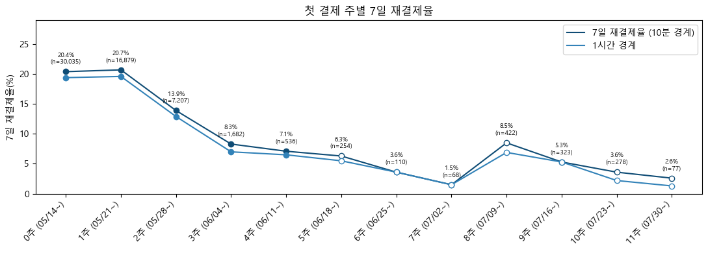
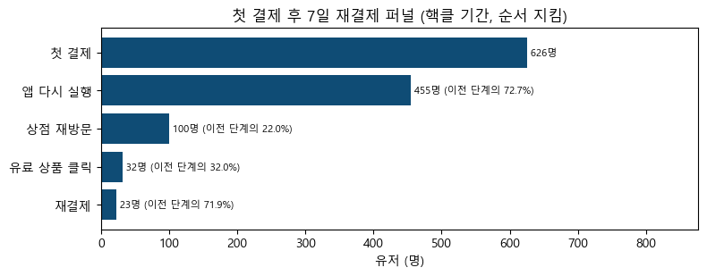
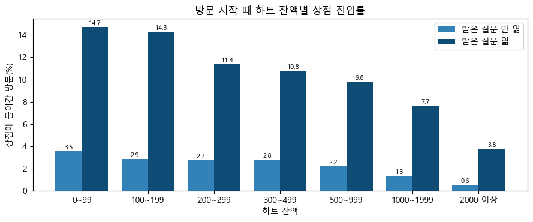
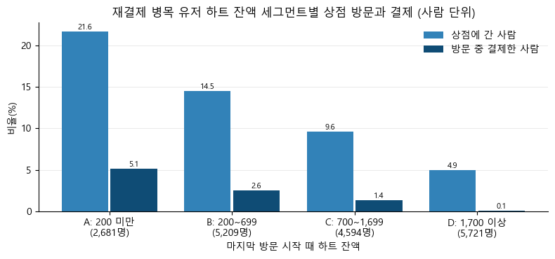
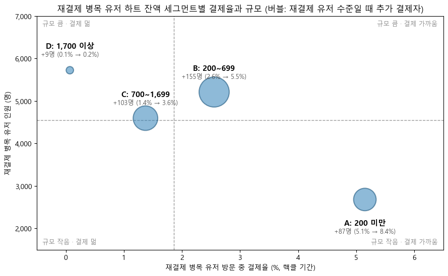
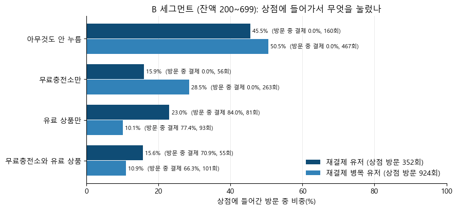

# 10대 익명 투표 SNS의 재결제 단절 분석 및 고객 세분화 전략

> 코드잇 스프린트 데이터 분석가 16기 · 고급 프로젝트 (파트 4) · 3팀 **강력계 3팀** (6인) · 2026.11

📄 [분석 보고서](./docs/report.pdf) · 🎤 [발표 자료](./docs/presentation.pdf) · 📓 [분석 노트북](./notebooks/rebilling_bottleneck_analysis.ipynb)

## 1. 배경 및 문제 정의

중·고등학생이 같은 학교 친구를 골라 익명으로 투표하는 SNS 앱입니다. 투표를 받은 학생은 **하트**로 힌트를 열어 자신을 고른 사람의 초성을 한 글자씩(200 → 500 → 1,000하트) 확인하고, 하트는 상점에서 사거나 무료충전소에서 얻습니다.

- **상황 설정**: 우리 팀 = 서비스 데이터 분석팀, 의사결정자 = PM, 분석 시점 = 2023년 8월 중순
- **목적**: 2023년 하반기 상품 판매액을 늘릴 전략 도출
- 신규 유입은 유입 경로·마케팅 기록이 없어 근거 있는 제안이 어려움 → **이미 결제한 학생의 재결제**에 집중

**핵심 질문**: 첫 결제자는 왜 다시 사지 않는가, 그리고 누구부터 다시 사게 만들 것인가?

| 단계 | 질문 |
|---|---|
| 1. 현상 | 재결제가 얼마나, 언제부터 줄었나 |
| 2. 병목 | 첫 결제 후 어느 단계에서 끊기나 |
| 3. 대상 | 재결제하지 않은 사람은 앱을 떠났나 |
| 4. 우선순위 | 누구부터 개선할 것인가 |
| 5. 개선안 | 세그먼트마다 무엇을 바꿀 것인가 |

## 2. 데이터

| 데이터 | 내용 | 기간 |
|---|---|---|
| 서비스 내부 DB (MySQL) | 유저·학교·반, 친구 요청, 결제, 출석, 투표·포인트 | 2023.03 ~ 2024.05 (분석은 ~2023.08.10) |
| Hackle 이벤트 로그 | 앱 실행, 상점 진입, 상품 클릭, 받은 질문 열기, 이벤트 시점 하트 잔액 | 2023.07.18 ~ 08.10 |

25개 테이블 중 22개를 사용했고, 최종 분석 대상은 **유저 673,418명 · 결제 92,944건 · 첫 결제자 58,266명**입니다.
테이블 구조는 [`data/README.md`](./data/README.md)에 정리했습니다.

## 3. 데이터 검증 및 분석 기준

| 이슈 | 처리 |
|---|---|
| 완전중복 | 198,273행 제거 (핵클 이벤트 195,247행, 결제 531건 포함) |
| 타임존 불일치 | 같은 결제가 서비스 DB와 핵클 구매 이벤트에서 9시간 차이 → 서비스 DB를 KST로 변환 |
| 비정상 계정 | 관리자·직원 4명, 포인트 100만 초과 테스트 계정 4명 제외 |
| 두 데이터셋 연결 | 핵클 session_id당 여러 행 → 숫자 user_id가 하나인 세션(92.1%)만 유저와 연결. 투표 단위가 아니라 **유저 단위**로 결합 |
| 재결제 정의 | 첫 결제 후 **10분~7일** 안의 결제. 10분 안은 같은 방문의 연속 결제로 분리 (포함하면 7월에 재결제가 회복한 것처럼 보이는 착시 발생) |
| 관찰 기간 7일 | 30일 안 재결제의 89.1%가 7일 안에 발생 + 핵클 기간 첫 결제자(627명)도 분석 가능. 1시간 경계로 바꿔도 결론 동일 |

## 4. 현상: 7일 재결제율 20% → 7%

- 결제 92,944건 중 **88.1%가 5월**에 몰림. 주별 첫 결제자도 30,035명 → 536명으로 감소
- 7일 재결제율은 첫 주 **20.4% → 한 달 뒤 7.1%**, 7/9~8/3 첫 결제자는 5.9%
- 재결제한 **18.8%가 첫 결제 후 7일 추정 매출의 44.9%**를 만듦
- 성별·학년·지역·첫 결제 상품을 통제한 로지스틱 회귀에서도 4주 이후 첫 결제자가 16.1%p 낮음 → 구성 차이로 설명되지 않음. 차이의 약 1/3은 **함께 활동한 같은 반 친구 감소**와 연관

## 5. 병목: 앱은 다시 켜지만 상점까지 가지 않는다

- 첫 결제자의 **72.7%가 7일 안에 앱을 다시 켰지만**, 상점에 다시 들어간 비율은 **16.0%**
- 상점 진입은 받은 질문의 힌트를 열 때 하트가 모자라는 순간에 주로 발생

- 방문 시작 하트 잔액이 많을수록 상점 진입이 줄어듦 (0~99: 6.72% → 2,000 이상: 1.27%)

## 6. 고객 세분화

**① 첫 결제자 3개 그룹** (첫 결제 후 7일 기준)

| 그룹 | 정의 | 인원 |
|---|---|---|
| 재결제 유저 | 재결제 있음 | 10,888명 (18.8%) |
| **재결제 병목 유저** | 재결제 없음 + 친구 요청·출석·투표·핵클 활동 기록 있음 | **43,136명 (74.5%)** |
| 이탈 유저 | 재결제 없음 + 활동 기록 없음 | 3,847명 (6.6%) |

→ 재결제하지 않은 사람의 **91.8%는 앱을 떠나지 않았음** → 병목 유저를 개선 대상으로 선정

**② 병목 유저의 하트 잔액 4개 세그먼트**

힌트 가격(200·500·1,000)을 누적한 **200 / 700 / 1,700**을 경계로, 잔액마다 "하트가 모자라는 단계"가 앱 기능과 이어지도록 나눴습니다. (핵클 기간 방문 기록이 있는 18,205명)

같은 세그먼트 **재결제 유저의 방문 중 결제율을 기준치**로 두고, 병목 유저가 그 수준에 이를 때의 추가 결제자로 우선순위를 정했습니다.

| 우선순위 | 세그먼트 | 병목 유저 결제율 → 기준치 | 개선 여지 |
|---|---|---|---|
| 1 | B (200~699) | 2.6% → 5.5% | +155명 |
| 2 | A (200 미만) | 5.1% → 8.4% | +87명 |
| 3 | C (700~1,699) | 1.4% → 3.6% | +103명 |
| 4 | D (1,700 이상) | 0.1% → 0.2% | +9명 |

> 기준치는 예상 효과가 아니라 **개선 여지**입니다. 재결제 유저는 원래 더 사는 사람일 수 있습니다.

## 7. 핵심 인사이트

1. 재결제가 끊긴 첫 결제자 대부분은 **앱을 떠나지 않았다** (91.8%)
2. 재결제는 **상점 진입 단계와 상점 안**에서 끊긴다. 같은 잔액 구간에서도 병목 유저는 유료 상품만 누른 방문이 재결제 유저의 절반 이하
3. 잔액마다 하트가 모자라는 단계가 달라 **세그먼트별로 다른 개입**이 필요하다

## 8. 개선안과 실험 설계

| 순위 | 대상 | 개선안 | 주 지표 |
|---|---|---|---|
| 1 | B (200~699) | 하트가 모자라는 순간 부족한 양과 추천 상품을 함께 보여 주는 결제 팝업, 유료 상품을 무료충전소보다 위에 배치 | 방문 중 결제율 |
| 2 | A (200 미만) | 상점 첫 화면 맨 위에 200하트(900원) + "받은 질문 첫째 글자 바로 열기" | 방문 중 결제율 |
| 3 | C (700~1,699) | 둘째 글자를 열 때 하트를 더 내면 셋째 글자까지 여는 묶음 열기 | 1인당 하트 사용량 |
| 4 | D (1,700 이상) | 하트로 사는 꾸밈 상품(아바타) 추가 *(데이터 근거 없는 가설)* | 1인당 하트 사용량 |
| 별도 | 앱 미사용 유저 | 저녁 18~21시 앱 푸시로 복귀 유도 후 세그먼트별 개선안 적용 | 7일 안 앱 복귀율 |

모든 개선안은 **같은 세그먼트 안에서 실험군·대조군을 무작위로 나눈 A/B 테스트**로 효과를 확인하도록 설계했습니다.
분석 결과를 PM이 지표로 추적할 수 있도록 **Looker Studio 대시보드**(GCS → BigQuery → Looker Studio)도 함께 구성했습니다.

## 9. 한계

- 행동 간 **관계**를 보여 줄 뿐 인과를 확인하지 않음 (잔액이 적은 것이 하트를 많이 쓴 결과일 수도 있음)
- 금액 컬럼이 없어 매출은 상품 판매가 기준 **추정 매출**
- 앱 안 행동은 핵클 기간(약 4주)만 관찰 가능 → 첫 결제자가 몰린 5월 행동은 직접 볼 수 없음
- 그룹(첫 결제 후 7일, 대부분 5월)과 세그먼트(7~8월 잔액)의 시점이 다름

## 10. 내 역할

- 1단계 EDA "첫 결제 열기는 왜 한 달 만에 식었나" 담당 (결제 시작일 전·후 가입자 구분)
- 재결제 병목 유저(G2)를 **더 세분화해서 봐야 한다**는 의견 제시 → 하트 잔액 세그먼트로 이어짐
- 최종 발표에서 **개선안 파트**(세그먼트별 개선안, 앱 밖 유저) 발표

## 11. 기술 스택

`SQL` `MySQL` `Python` `pandas` `NumPy` `scikit-learn` `Matplotlib` `BigQuery` `Looker Studio` `Google Colab`
